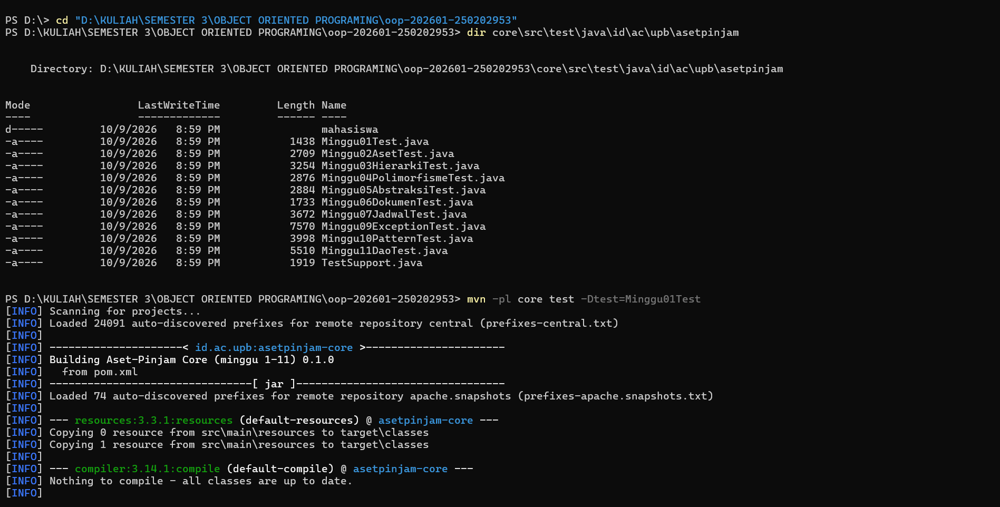
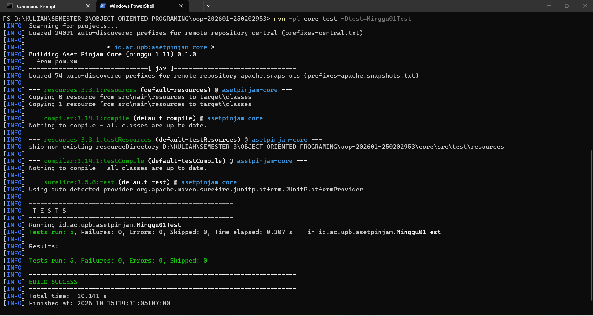

## Yang saya kerjakan
Yang saya kerjakan yaitu mengisi 'HelloProsedural', 'HelloOOP', 'HelloFungsional' sampai ketiganya menghasilkan kalimat sapaan yang sama, yaitu "Aset-Pinjam", nama, dan NIM saya. Saya juga mengisi 'mahasiswa.properties' dan mengunduh JDK 21 dan Maven. Serta menguji hasilnya dengan menjalankan 'scripts/uji.sh'.

## Keputusan desain
Kalimat sapaan dibuat sama di ketiga gaya pemrograman supaya hasilnya konsisten.

## Kendala
saya aga kesulitan tentang maven yang tidak bisa ke baca di vscode.

## Penggunaan AI
- Alat yang dipakai: Cloud
- Bagian yang dibantu AI: HelloFungsional.java, HelloOOP.java, HelloProsedural.java
- Prompt utama: kode apa yang harus di isi untuk buat kalimat sapaan di HelloFungsional.java, HelloOOP.java, HelloProsedural.java
- Yang saya ubah atau tolak dari saran AI, dan alasannya: tidak ada yang saya ubah dari AI
- Satu hal yang saya pahami lebih baik sekarang:Satu hal yang saya pahami lebih baik sekarang: Program yang hasilnya sama ternyata bisa
  disusun dengan cara berpikir berbeda. Di OOP data dibungkus dalam class dengan field
  private, sedangkan di gaya fungsional saya cukup mengembalikan sebuah fungsi lewat lambda.
  Dari situ saya jadi paham bahwa pemilihan paradigma bergantung pada kebutuhan sistem.

## uji test
 
