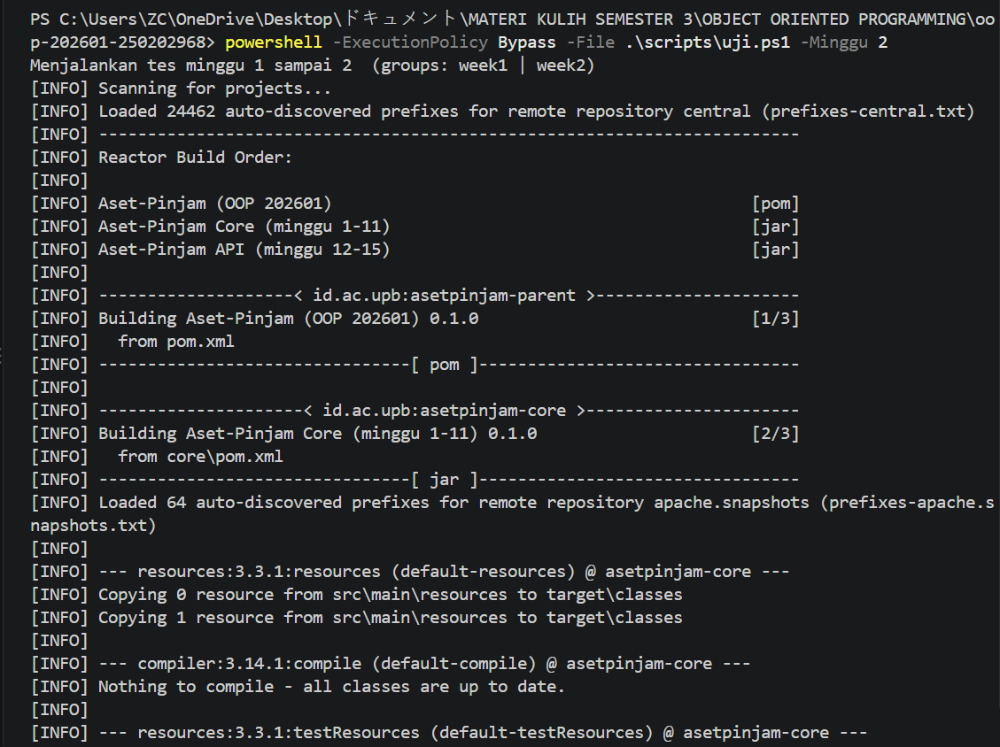
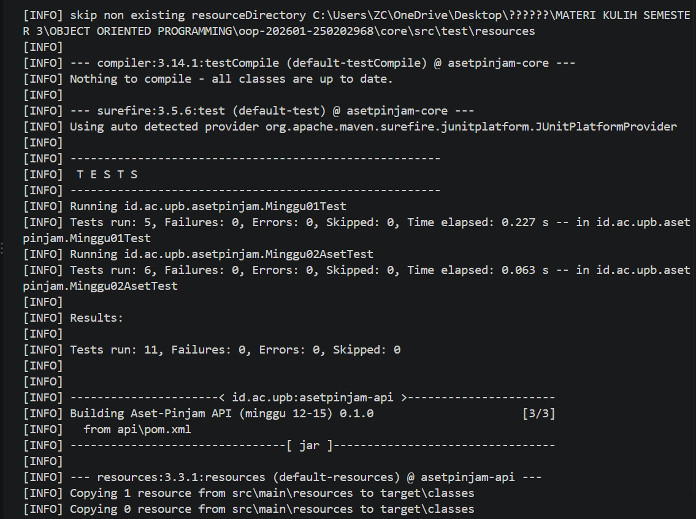
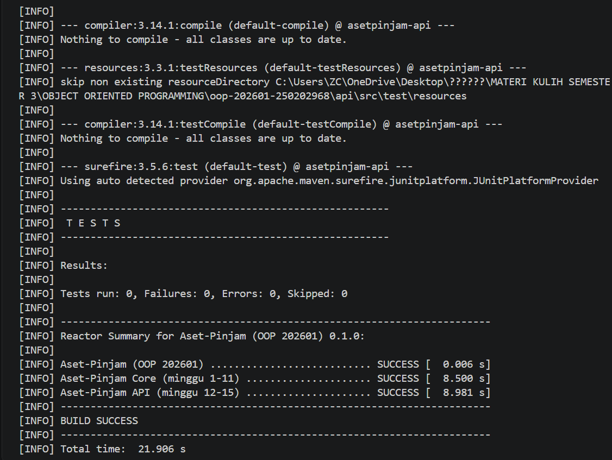
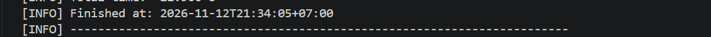

# Catatan Minggu-02.md : Struktur OOP: Class, Object, Encapsulation

## Yang saya kerjakan
Pada minggu ini saya melengkapi class `Aset.java` dengan melengkapi artibut, konstruktor, getter, dan setter. Semua artibut saya atur menggunakan asded private agar data tidak dapat diakses atau dibubah secara langsung dari luar class.Aku juga menambahkan aturan supaya data aset nggak boleh kosong atau null sesuai dengan persyaratan tugas.

## Keputusan desain
Saya menggunakan `private` di semua aturan supaya datanya lebih terlindungi. Aturan `kode` nggak punya setter karena nggak perlu diubah. Nilai awal status adalah `TERSEDIA` dan kondisinya `BAIK`. Aku juga nambahin validasi supaya kode, nama, status, dan kondisi nggak bisa kosong atau `null`.

## Kendala
Masalah saya adalah menjalankan skrip di PowerShell. Saya menyelesaikannya dengan perintah `ExecutionPolicy Bypass` dan menggunakan parameter `-Week 2` untuk menjalankan tes.

## Penggunaan AI
- Alat yang dipakai: ChatGPT
- Bagian yang dibantu AI: Class `Asset.java`, Khususnya konstruktor, getter, setter
- Prompt utama: Apakah kode constructor dan setter saya sudah sesuai dengan ketentuan validasi?
- Yang saya ubah atau tolak dari saran AI, dan alasannya: Aku menyesuaikan beberapa bagian kode supaya sesuai dengan aturan dan kebutuhan tugas Minggu 02.
- Satu hal yang saya pahami lebih baik sekarang: Saya lebih paham konsep enkapsulasi, yaitu melindungi data dengan private dan mengatur akses melalui getter dan setter dengan validasi.

## uji test

